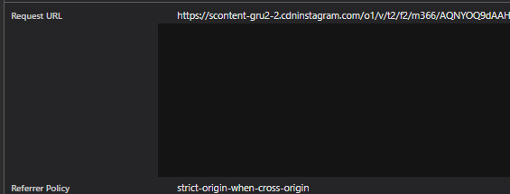
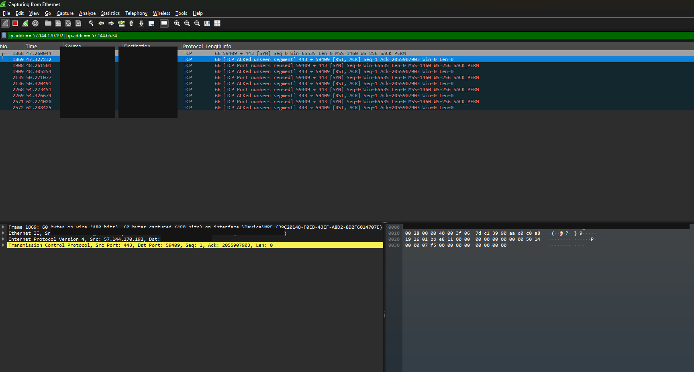
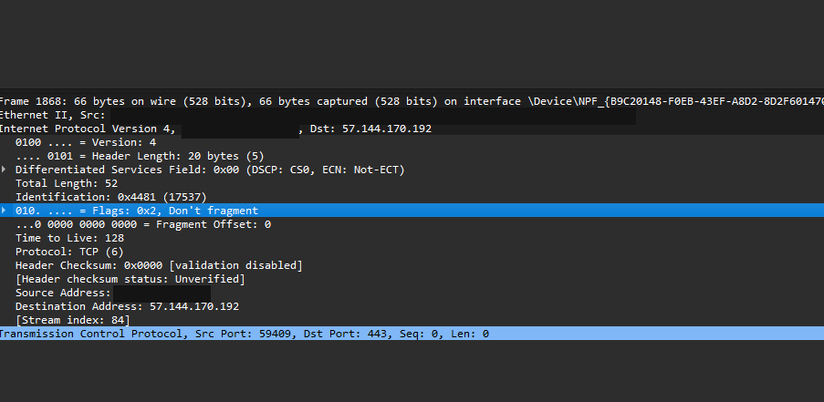

# Estudo de Caso: Diagnóstico de Conectividade a um Serviço Externo em Rede Corporativa

> Exercício prático de diagnóstico de rede. A partir de um comportamento de conectividade observado em um serviço externo (a rede social **Instagram**, usada aqui como alvo de teste real), a investigação percorre o método — DNS, TCP, análise de pacotes — até a causa-raiz: um reset TCP injetado por firewall. O foco é a **metodologia de diagnóstico** e a leitura de pacotes, não o serviço em si.

---

## Objetivo e contexto

Este documento registra um **estudo de redes** conduzido com fins de aprendizado e documentação de método. O objetivo foi exercitar, de ponta a ponta, o diagnóstico de um problema de conectividade: formular hipóteses, testá-las com ferramentas de rede e chegar a uma conclusão sustentada por evidência.

Como alvo de teste foi escolhido um serviço externo público e amplamente conhecido — a rede social **Instagram** —, cujo carregamento de mídia apresentava um comportamento irregular na rede, o que o tornava um bom caso real para a prática. Todo o trabalho se limitou à **observação do tráfego da própria máquina** com ferramentas de diagnóstico padrão; nenhum controle de segurança foi testado, alterado ou contornado.

---

## Resumo (TL;DR)

Ao diagnosticar a conectividade a um serviço externo (Instagram), observou-se que parte da mídia (imagens e vídeos) não carregava, enquanto o site em si abria normalmente. A investigação mostrou que o firewall da rede **rejeita ativamente** as conexões aos servidores de mídia da Meta (CDN `*.cdninstagram.com`), respondendo ao `SYN` do cliente com um pacote `RST` **forjado**, se passando pelo servidor de destino.

A prova definitiva veio da análise do campo **TTL** do pacote de reset: ele chegou com `TTL = 63`, indicando origem a **um único salto** de distância (o próprio firewall), e não dos servidores da Meta, que estariam a mais de uma dezena de saltos pela internet.

---

## Ambiente

| Item | Valor |
|---|---|
| Sistema | Windows 10 (`10.0.26200`) |
| Ferramentas | `nslookup`, `tracert`, `Test-NetConnection` (PowerShell), Wireshark 4.4.8, DevTools do navegador |
| Rede | Rede corporativa `[REDIGIDO]` |
| Gateway/Firewall | `[IP_PRIVADO_GATEWAY]` (fabricante Hewlett-Packard, identificado pelo MAC) |
| Alvo bloqueado | `scontent-gru2-2.cdninstagram.com` → `57.144.170.192` (servidor de mídia da Meta) |
| Alvo funcional | `www.instagram.com` → `57.144.66.34` |

---

## Sintoma observado

O serviço escolhido como alvo de teste (Instagram) apresentava o seguinte comportamento na rede:

- O site `instagram.com` abre: feed, mensagens e textos aparecem.
- **Algumas imagens e vídeos não carregam**; a interface exibe "Estamos com problemas para reproduzir este vídeo".
- Comportamento consistente e reproduzível, o que o tornou um bom caso para a investigação.
- No DevTools (aba Network), requisições a `*.cdninstagram.com` apareciam ora com status `200`, ora como `(failed)` após ~42 s, com o aviso *"Provisional headers are shown"* (nenhuma resposta recebida).



*A requisição que falha é um vídeo (`.mp4`) servido pelo host de mídia `scontent-gru2-2.cdninstagram.com`. Tokens da URL redigidos.*

---

## Metodologia

### 1. DNS está funcionando?

```
nslookup scontent-gru2-2.cdninstagram.com
```

Resultado: o nome resolveu normalmente para um IP válido da Meta (`57.144.170.192`).
**Conclusão:** não é bloqueio por DNS.

### 2. O caminho até o destino

```
tracert -d 57.144.170.192      # alvo bloqueado → para logo após o 1º salto (gateway)
tracert -d -h 6 8.8.8.8        # controle → percorre todos os saltos normalmente
```

O `tracert` para o alvo morre no primeiro salto, enquanto o teste de controle (8.8.8.8) atravessa a rede sem problema.
**Conclusão:** o problema está concentrado no caminho para esse destino específico, não na conectividade geral.

### 3. A conexão TCP na porta 443 completa?

```powershell
Test-NetConnection 57.144.170.192 -Port 443   # TcpTestSucceeded : False  (bloqueado)
Test-NetConnection www.instagram.com -Port 443 # TcpTestSucceeded : True   (funciona)
```

Dois endereços da **mesma faixa** da Meta (`57.144.x`), comportamentos opostos.
**Conclusão:** o bloqueio é seletivo, por IP/sub-faixa, não por domínio inteiro.

### 4. Captura de pacotes (Wireshark)

Filtro de exibição aplicado:

```
ip.addr == 57.144.170.192 || ip.addr == 57.144.66.34
```

Sequência observada no alvo bloqueado:

```
Origem           Destino          Protocolo  Info
192.168.x  →     57.144.170.192   TCP        [SYN]        Seq=0 Win=65535 MSS=1460 WS=256 SACK_PERM
57.144.170.192 → 192.168.x        TCP        [RST, ACK]   Seq=1 Ack=2055907903 Win=0 Len=0
```

O cliente envia `SYN`; a resposta é um `RST, ACK` (conexão recusada), e não o `SYN, ACK` esperado de um servidor real. O cliente reenvia o `SYN` várias vezes e recebe `RST` toda vez.



*Cada `SYN` (porta 59409 → 443) é respondido por um `RST, ACK` (443 → 59409). No painel de bytes, a linha `0010` traz `... 40 00 3f 06 ...`: o `3f` é o TTL = 63 do pacote de reset. Endereços internos e MACs redigidos; IP público da Meta mantido.*

---

## Análise: o reset é injetado (forjado)

Três indícios apontam que o `RST` **não** veio do servidor da Meta, mas de um equipamento intermediário:

1. **Latência baixa demais** — o `RST` volta em ~67 ms, incompatível com um servidor distante.
2. **Assinatura do pacote** — `RST, ACK` com `Win=0` e um número de `ACK` arbitrário e alto é padrão clássico de reset injetado por firewall/IPS.
3. **TTL — a prova definitiva:**

O pacote `RST` chegou com **`TTL = 63`** (lido no cabeçalho IP; byte `3f` em hexadecimal).

- Equipamentos de rede baseados em Linux iniciam o TTL em **64**.
- Cada salto (roteador) decrementa o TTL em 1.
- `63 = 64 − 1` → **um único salto de distância**: o firewall/gateway local.
- Um pacote legítimo vindo dos servidores da Meta cruzaria a internet (mais de 10 saltos) e chegaria com TTL bem menor (tipicamente ~48–52).



*O `SYN` de saída parte com `Time to Live: 128` (padrão do Windows), confirmando a tabela de TTL inicial. O `RST` que retorna chega com TTL 63 — assinatura de origem a um salto, o firewall local.*

**Portanto:** o firewall intercepta o `SYN` e responde um `RST` falsificado com o IP de origem da Meta, encerrando a conexão antes que ela saia da rede local.

### Referência rápida de TTL inicial

| Sistema | TTL inicial |
|---|---|
| Windows | 128 |
| Linux / macOS / equipamentos de rede | 64 |
| Alguns roteadores/sistemas antigos | 255 |

O `SYN` de saída deste caso tinha `TTL = 128` (Windows), confirmando a tabela.

---

## Conclusão

O firewall corporativo está configurado com uma regra de **reject** para os servidores de mídia (CDN) da Meta na faixa `57.144.x`. Isso explica todos os sintomas:

- O site (`www.instagram.com`) carrega porque o IP dele não está na regra de bloqueio.
- Imagens e vídeos falham porque vêm dos servidores de CDN que **estão** bloqueados.
- O padrão é coerente com uma regra de filtro por reputação/categoria de IP, ou com a Meta passando a servir mídia por uma faixa de IP que o firewall não reconhece/permite.

A resolução é administrativa (ajuste da regra pela equipe de TI), não técnica do lado do cliente.

---

## O que este caso ensina

- **Separar camadas:** "o nome resolve" (DNS) é diferente de "a conexão abre" (TCP). Diagnosticar exige testar cada uma.
- **Drop vs. Reject:** um firewall pode *descartar em silêncio* (timeout) ou *rejeitar ativamente* (RST). Este caso é reject.
- **RST injection:** firewalls forjam pacotes de reset com o IP do destino para encerrar conexões. Detectável por latência e TTL.
- **Análise de TTL:** comparar o TTL recebido com o TTL inicial esperado revela a distância real da origem — e expõe pacotes forjados.
- **CDN:** serviços grandes servem conteúdo de dezenas de servidores; bloquear parte deles quebra o serviço parcialmente.

---

## Como reproduzir (laboratório seguro)

Para estudar drop vs. reject e injeção de RST sem tocar em rede de produção:

1. Instale **pfSense** ou **OPNsense** em uma VM (VirtualBox/VMware).
2. Crie uma regra de firewall com ação **Reject** para um IP de teste e observe o `RST`.
3. Troque a ação para **Drop** (ou **Block**) e observe o timeout (sem resposta).
4. Capture ambos os cenários no Wireshark e compare os TTLs e as flags.

---

## Nota sobre privacidade

IPs privados internos, MACs de equipamentos, nome de usuário e domínio interno foram redigidos — no texto e com tarjas pretas nas imagens da pasta `evidencias/`. Os IPs públicos da Meta foram mantidos por serem informação pública. Nenhum controle de segurança foi contornado; toda a captura é do tráfego da própria máquina, para fins de diagnóstico e estudo.
